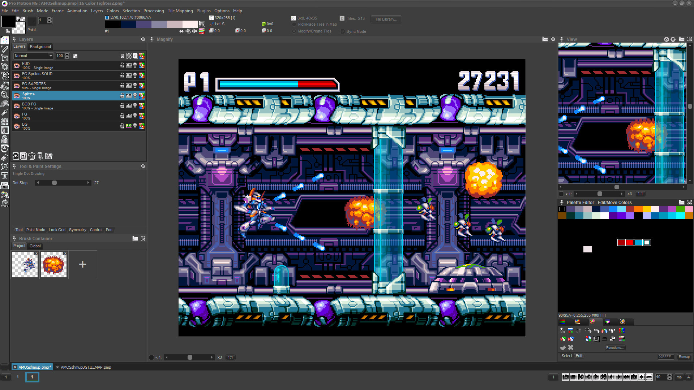
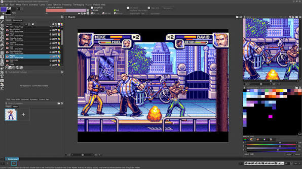

# Pro Motion NG: Reusable Pixels, Animated Worlds

A reusable tile can appear across an entire level, while a palette entry can color hundreds of pixels.
Pro Motion NG brings those repeated elements into a Windows drawing and animation workflow.
Plan what should stay shared before refining the individual details.

## Paint the tile while seeing the level

Start a small map that contains the same tile in several places.
Pro Motion NG lets you edit tile graphics in place, with changes updating other instances that use that tile.
Use that behavior deliberately when refining a wall, path, or repeating background.

A map entry identifies a tile; it is not a separate copy of the tile's pixels.
If one placement needs a unique mark, create a suitable variation instead of accidentally changing every instance.
Keep the distinction visible while switching between placing tiles and modifying their artwork.

### Separate reusable structure from local decoration

- Use repeated tiles for the main ground, walls, and other shared surfaces.
- Reserve variations for cracks, plants, shadows, and distinctive landmarks.
- Check corners and transitions before expanding a map.
- Include an isolated tile and a dense repeated area in the review.
- Keep the original tile set before reorganizing its entries.

Pro Motion NG's tile-map workflow distinguishes Pick/Place Tiles from Modify/Create Tiles.
Confirm the active mode before making a brush stroke.
Mirrored placements can reuse graphics, but their direction must remain correct in the exported map.

### Examine the relation between image and metadata

Tiled's [wangblob.tsx](tests/wangtiles/wangblob.tsx) describes a mixed Wang-set test fixture.
Its associated tile image is [wangblob.png](tests/wangtiles/wangblob.png).
The edge-based fixture [walkways.tsx](tests/wangtiles/walkways.tsx) references [walkways.png](tests/wangtiles/walkways.png).

Those examples separate tile pixels from information about how tiles connect.
Use the same distinction when writing down the assumptions behind your own terrain set.

[](https://pro-motion-ng.github.io/Pro-Motion-NG/)

## Reserve the colors the target can actually use

Choose the destination's color requirements before polishing every shade.
A retro target may restrict the palette, colors within a small region, or available tile memory.
Write down the actual platform rules rather than relying on a generally retro appearance.

Pro Motion NG provides palette editing, gradients, shade modes, and features for constrained graphics.
Keep outlines, material ramps, and animated colors organized by purpose.
A palette change can affect every pixel using the changed entry.

### Test the ramp on real shapes

Draw a small sample containing a highlight, middle tone, and deep shadow.
Check whether the transitions describe the intended material.
Then compare the sample with the background on which it will appear.

- Keep the darkest important edges readable against the scene.
- Compare nearby materials before adding another shade.
- Reserve transparency intentionally when the output uses a transparent color.
- Check color constraints using the target's actual limits.
- Save a revision before rearranging palette entries.



A palette that works for one isolated sprite may fail when several materials meet.
Review a character beside the terrain, effects, and interface colors.
Keep a note of which entries may be changed together.

## Define the tile-set handoff before exporting

A tile image is only part of the asset.
The receiving tool also needs enough information to locate each tile and interpret map entries.
Agree on the layout before producing a large collection of maps.

Pro Motion NG's tile export settings control the tile-set image layout and map-data format.
The documented default tile-set export includes the empty zero tile.
Preserve that convention or convert it explicitly when the receiving pipeline expects something else.

| Handoff detail | Record explicitly | Consequence of a mismatch |
| --- | --- | --- |
| Cell dimensions | Tile width and height in pixels | Incorrect slicing |
| Image layout | Columns, margins, and spacing | Shifted tile rectangles |
| Empty entry | Which index means no visible tile | Unexpected graphics in empty areas |
| Orientation flags | Horizontal and vertical mirroring conventions | Reversed patterns or objects |
| Map dimensions | Width and height in tile cells | A distorted or truncated level |
| Tile ordering | How identifiers correspond to the exported image | Correct shapes paired with wrong graphics |

### Describe a plain grid to Tiled

This original TSX example describes a 128-by-64 PNG containing thirty-two 16-by-16 tiles.
It assumes eight columns, no margins, and no spacing.
Use it with your own exported terrain.png when creating a matching external tileset in Tiled.

```xml
<?xml version="1.0" encoding="UTF-8"?>
<tileset name="terrain" tilewidth="16" tileheight="16" tilecount="32" columns="8">
 <image source="terrain.png" width="128" height="64"/>
</tileset>
```

The declaration describes the image grid; it does not reconstruct a Pro Motion map automatically.
If the export includes an empty tile, keep its position consistent with the map-data conversion.
A plain PNG does not carry all tile identifiers, map placements, or terrain rules.

### Compare other tile-set descriptions

Tiled's [PathAndObjects.tsx](tests/wangtiles/PathAndObjects.tsx) contains corner-based Wang-set metadata.
Its source image is [PathAndObjects.png](tests/wangtiles/PathAndObjects.png).
The fixture [grassAndWater.tsx](tests/wangtiles/grassAndWater.tsx) includes an isometric grid declaration and references [grass_and_water.png](tests/wangtiles/grass_and_water.png).

Image dimensions, logical grid dimensions, and drawing offsets can be separate values.
Keep those measurements distinct when preparing isometric artwork.

## Prove the rules on a small map

Before scaling up a terrain collection, build a compact map with representative joins.
Include an inner corner, an outer corner, a border, a repeated region, and a mirrored placement if relevant.
Compare the intended arrangement with what the destination actually displays.

### Render a working Tiled map for review

With Tiled's tmxrasterizer available, this command renders a complete TMX map at twice its normal scale.
The input must have its referenced tilesets and images available.
Choose an unused output filename.

```sh
tmxrasterizer --scale 2 "level.tmx" "level-review.png"
```

This produces a viewing image rather than an editable map.
Check the render against the map's intended layer visibility.
The supplied manual source [tmxrasterizer.1.ronn](man/tmxrasterizer.1.ronn) documents the tool's options.

### Follow an input, rule, and expected result

Tiled's simple replacement fixture pairs [map.tmx](tests/automapping/simple-replace/map.tmx) with [rules.tmx](tests/automapping/simple-replace/rules.tmx).
Its [rules.txt](tests/automapping/simple-replace/rules.txt) identifies the rule file.
[map-result.tmx](tests/automapping/simple-replace/map-result.tmx) stores the expected result.

The two-by-two fixture provides another compact comparison:
[map.tmx](tests/automapping/simple-2x2-rule/map.tmx), [rules.tmx](tests/automapping/simple-2x2-rule/rules.tmx),
[rules.txt](tests/automapping/simple-2x2-rule/rules.txt), and [map-result.tmx](tests/automapping/simple-2x2-rule/map-result.tmx).

Use these as examples of documenting a transformation with a known starting point.

### Inspect corners, flips, and boundaries separately

The terrain-corner fixture includes [map.tmx](tests/automapping/terrain-corner/map.tmx),
[rules.tmx](tests/automapping/terrain-corner/rules.tmx), [rules.txt](tests/automapping/terrain-corner/rules.txt),
and [map-result.tmx](tests/automapping/terrain-corner/map-result.tmx).
Its tile-set description is [isometric_grass_and_water.tsx](tests/automapping/terrain-corner/isometric_grass_and_water.tsx).

Flip-related cases appear in [map.tmx](tests/automapping/ignore-flip/map.tmx),
[rules.tmx](tests/automapping/ignore-flip/rules.tmx), and [map-result.tmx](tests/automapping/ignore-flip/map-result.tmx).
The overflow-border fixture supplies [map.tmx](tests/automapping/option-overflow-border/map.tmx),
[rules.tmx](tests/automapping/option-overflow-border/rules.tmx), and [map-result.tmx](tests/automapping/option-overflow-border/map-result.tmx).

These fixtures exercise Tiled behavior; use equivalent visual cases when checking your own export conversion.
The source [test_mapreader.cpp](tests/mapreader/test_mapreader.cpp) provides a reference for Tiled's map-reading tests.
A successful read and a correct rendered level remain different checks.

## Animate the right property of the artwork

Choose whether an effect needs changing pixels, changing frames, or changing palette colors.
A walking character generally needs distinct poses.
A flowing-water effect may instead be built around a controlled palette cycle.

Pro Motion NG supports frame animation, onion skinning, and color cycling.
Keep the movement readable at normal viewing size before polishing every intermediate frame.
Review the final-to-first transition when the result must loop.

### Keep cycling ranges intentional

The Gradient Editor supports color cycling for a linear range of palette entries.
Assign a suitable speed and avoid overlapping cycling gradients.
Preview the effect while comparing the surrounding colors that should remain stable.

To turn the cycling result into an animation that can be stored in a file, Cosmigo documents Animation > Create from Color Cycling.
Reopen the exported animation to check its timing and transparency.
Retain the indexed source so the palette-based effect can still be revised.



### Keep animated layers understandable

Separate a stable background from a moving character when that makes the sequence easier to edit.
Check the selected layer and frame before copying a region.
For shared tile graphics, confirm that a correction has not changed unrelated map placements.

When handing over a sprite sheet, include frame dimensions, order, and any animation metadata needed by the game.
A sheet image alone does not explain every playback decision.

## Extend the workflow with a compatible plugin

Pro Motion NG exposes plugin interfaces, and Cosmigo hosts PureBasic interface materials.
Use the plugin's documented host version and architecture requirements.
Check a small copied project after adding an export extension.

For a Pro Motion NG V8 workflow, check the plugin's stated compatibility and bitness.
Do not infer compatibility from a DLL filename or an old example alone.
Keep the application version, plugin version, and exact export operation with a problem report.

### Keep post-processing separate from drawing

Cosmigo's Tile Mapping Data Export dialog can run a selected application after export.
The documented arguments are the export folder and project name.
Use that handoff for a defined conversion step, then check the produced map in the destination.

Consult the official [tile-mapping primer](https://www.cosmigo.com/promotion/docs/onlinehelp/tileMappingPrimer.htm),
[tile export guide](https://www.cosmigo.com/promotion/docs/onlinehelp/tileMappingDataExportDlg.htm),
and [gradient editor guide](https://www.cosmigo.com/promotion/docs/onlinehelp/gradientEditDlg.htm) for the native controls.
The [Cosmigo PureBasic interfaces](https://github.com/cosmigo/pmotion-purebasic) document a separate plugin-development resource.

## Related Search Terms

Pro Motion NG, Pro Motion NG, cosmigo pro motion ng, pro motion ng v8, pro motion ng plugins, pixel-art, animation, sprites, spritesheet, tile-editor, tilemap-editor, tilesets, level-editor, game-development, plugins
